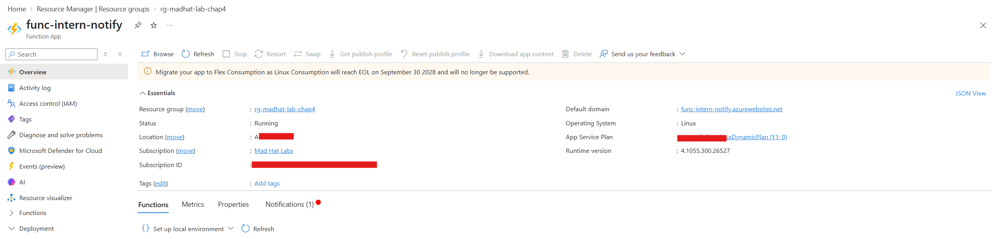
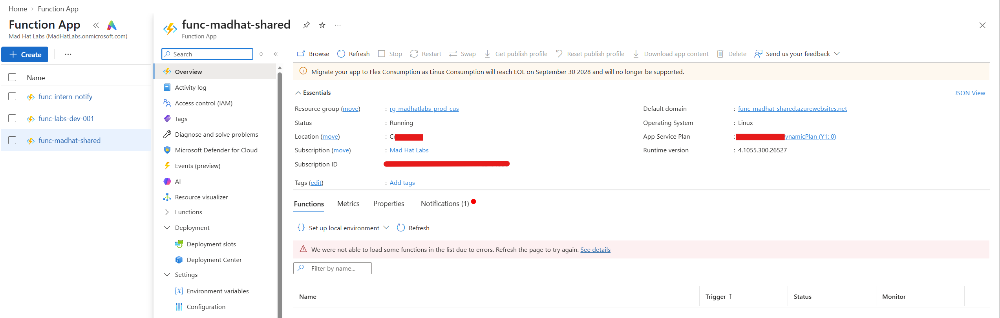
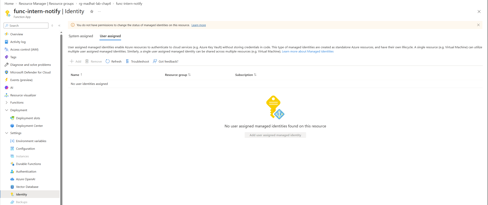
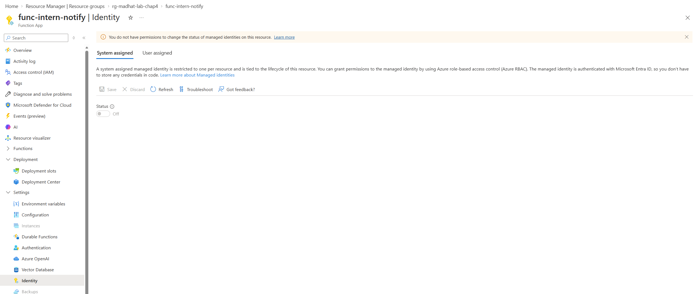
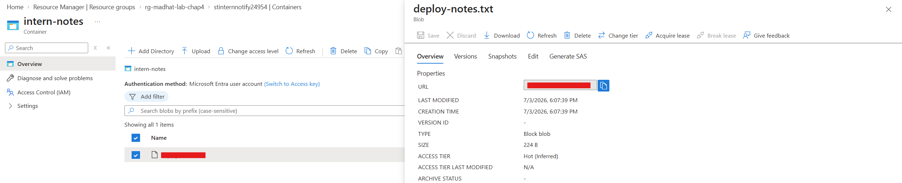
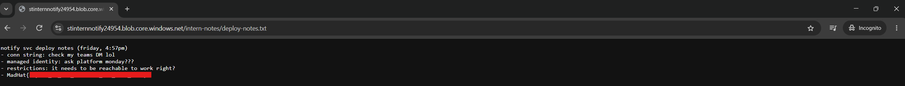
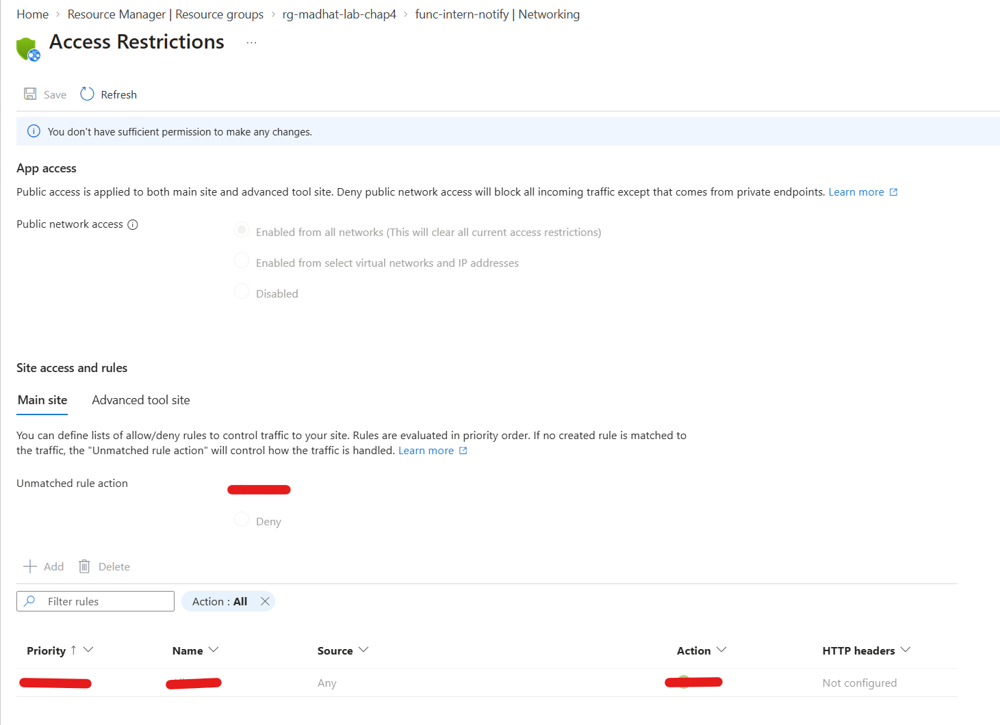
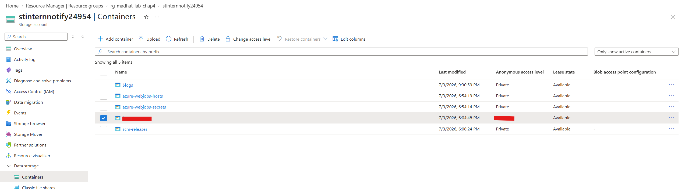

# The Friday Deploy: Pre-Production Security Review

## Executive Summary

A pre-production security review was conducted against a newly deployed Azure Function App before promotion to production. The deployment was evaluated against an existing production baseline using Reader-level access.

Four significant findings were identified involving regional placement, workload identity, public data exposure, and inbound network access. The most critical finding was a publicly accessible storage container that was verified from an unauthenticated browser session. Because this represented active exposure rather than a potential future risk, it was prioritized above all other findings.

---

# Context and Scope

A newly deployed notification service, **func-intern-notify**, was reviewed within the **rg-madhat-lab-chap4** resource group before production promotion.

Access was restricted to Reader permissions. No deployment standard documentation was provided, so an existing production service, **func-madhat-shared**, was used as the baseline for comparison.

---

# Methodology

The review compared the new deployment against a known-good production implementation across four areas:

1. Regional placement
2. Workload identity
3. Data exposure
4. Network accessibility

Findings were validated through direct observation and testing whenever possible.

---

# Finding 1: The Where

## Observation

The Function App **func-intern-notify** was deployed in Australia East while the production baseline **func-madhat-shared** operates in Central US.

## Verification

The Location field on each Function App Overview page was reviewed and compared directly.

### Evidence

*Figure 1: Intern deployment located in Australia East.*

*Figure 2: Production Function App located in Central US.*

## Why It Matters

Deploying compute resources in a different region than their dependent services introduces unnecessary latency and can generate Azure egress charges whenever data crosses regional boundaries.

Azure does not charge for ingress (data entering Azure), but outbound cross-region traffic is billable.

## Recommendation

Redeploy the Function App into the standard production region to align compute resources with the remainder of the platform.

**Severity:** Medium

---

# Finding 2: The Who

## Observation

The Function App had no managed identity configured.

## Verification

The Identity blade showed that the System Assigned identity was disabled and no User Assigned identities were attached.

### Evidence

*Figure 3: No user-assigned managed identity configured.*

*Figure 4: System-assigned identity disabled.*

## Why It Matters

Without a managed identity, applications typically authenticate using stored credentials such as connection strings or access keys.

Stored secrets must be protected, rotated, and monitored, increasing operational risk.

## Recommendation

Attach a user-assigned managed identity and remove stored credentials where possible.

**Severity:** Medium

---

# Finding 3: The Leak

## Observation

A storage container was configured for anonymous public access.

## Verification

A blob URL was copied from the container and opened in a private browser session. The file loaded successfully without authentication.

### Evidence

*Figure 5: Container configured with anonymous access.*

*Figure 6: Blob successfully accessed while unauthenticated.*

## Why It Matters

This finding represents an active exposure rather than a theoretical weakness.

Data stored within the container was accessible to anyone possessing the URL.

## Recommendation

Disable anonymous access immediately and review all content for potential exposure.

**Severity:** High

---

# Finding 4: The Door

## Observation

The Function App had no meaningful inbound access restrictions.

## Verification

The access restriction configuration showed public access enabled, traffic from any source allowed, and unmatched traffic configured to Allow.

### Evidence

*Figure 7: Public access enabled with no meaningful restrictions.*

## Why It Matters

The application was designed to run scheduled activities and does not require unrestricted inbound internet access.

Leaving the application reachable expands the attack surface unnecessarily.

## Recommendation

Implement the same access restriction model used by the production workload.

**Severity:** Medium

---

# Finding 5: The Call

## Priority Assessment

Four findings were identified:

1. Wrong region
2. Missing managed identity
3. Public storage container
4. Unrestricted inbound access

### Evidence Supporting Priority

*Figure 8: Publicly accessible container identified during review.*

## Recommended Priority Order

| Priority | Finding | Reason |
|-----------|-----------|-----------|
| 1 | Public Storage Container | Active exposure verified through testing |
| 2 | Open Inbound Access | Unnecessary attack surface |
| 3 | Missing Managed Identity | Increased credential-management risk |
| 4 | Wrong Region | Cost and performance inefficiency |

## Decision

The public storage container should be remediated immediately.

Unlike the remaining findings, this issue was verified as an active exposure. Data was accessible without authentication from an unauthenticated browser session. The remaining issues should be addressed as part of deployment hardening and platform standardization efforts.

> Exposure beats hygiene. Active beats potential.

---

# Recommendations

## Immediate Actions

1. Disable anonymous access on the storage container.
2. Review publicly accessible content.
3. Validate storage permissions.

## Short-Term Actions

4. Add inbound access restrictions.
5. Attach a user-assigned managed identity.
6. Remove stored credentials.

## Long-Term Improvements

7. Standardize deployment regions.
8. Create a pre-production deployment checklist.
9. Require deployment reviews before production promotion.

---

# Lessons Learned

This review demonstrated the value of comparing new deployments against a known-good production baseline.

The exercise also reinforced the importance of validating risk through direct testing and prioritizing active exposure above theoretical concerns.

The most important outcome was not finding the issues themselves, but determining which issue required immediate remediation.

---

# Resume Bullet

> Performed a pre-production security review of an Azure Function App deployment against an established production baseline. Evaluated region placement, workload identity, storage exposure, and network access controls. Verified anonymous public access to cloud storage through unauthenticated testing and delivered a risk-prioritized remediation plan emphasizing active exposure over configuration hygiene.
