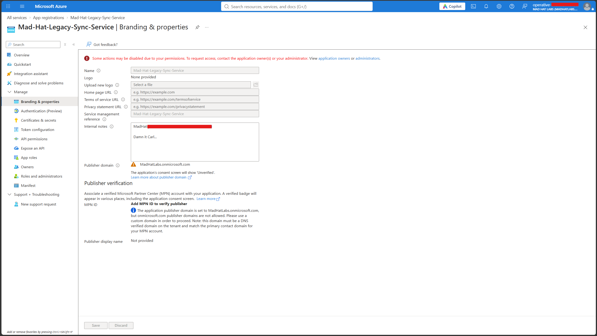
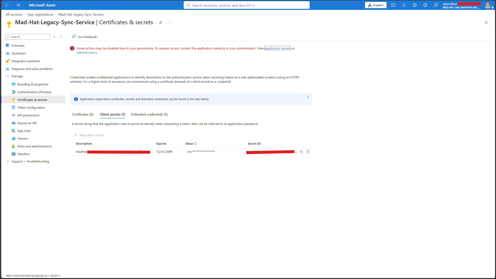
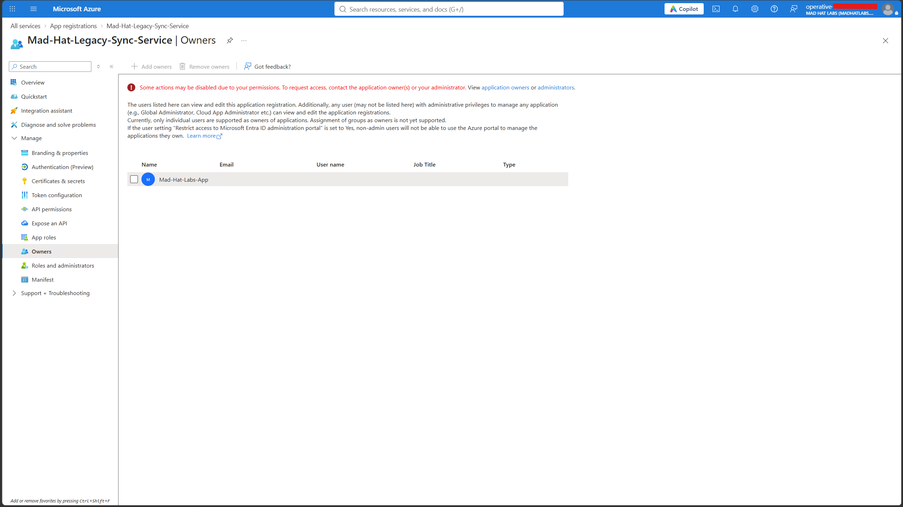
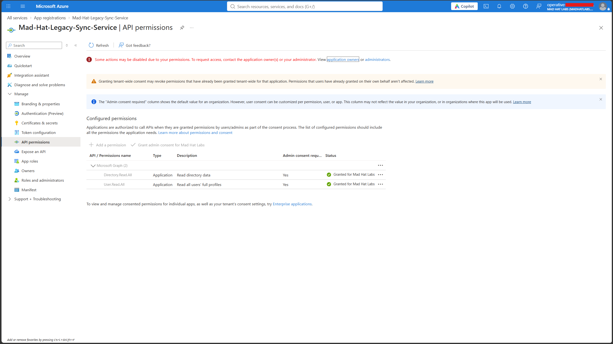
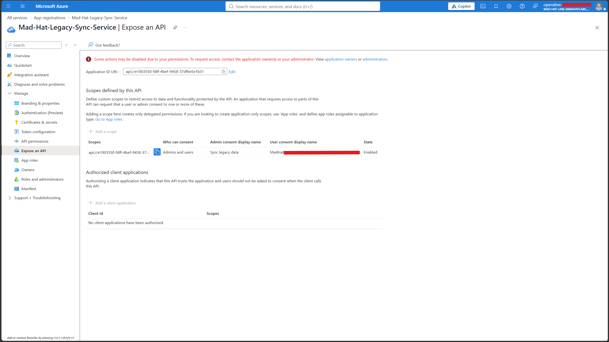
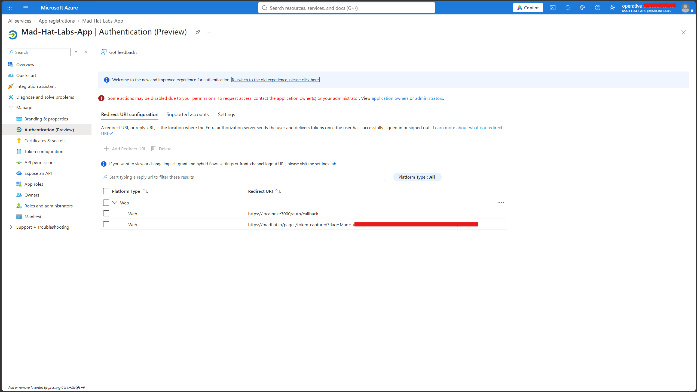
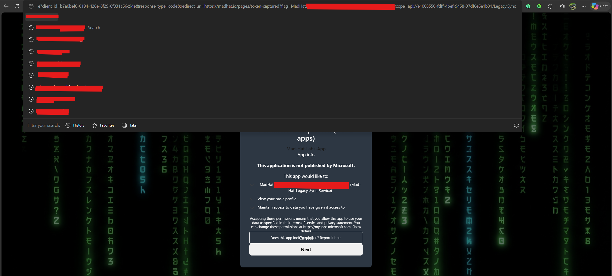

# Reconstructing an OAuth Consent-Phishing Attack Through Linked Entra ID Applications

## Scenario

A suspicious relationship between two application registrations was identified within an Entra ID tenant. The objective of the investigation was to reconstruct a multi-stage OAuth consent-phishing attack involving a compromised user, a legacy application registration, and an attacker-created application. The investigation focused on determining how the attacker established persistence, expanded access through application ownership, and ultimately positioned themselves to harvest OAuth tokens from tenant users.

## Environment

- Microsoft Entra ID
- App Registrations
- Enterprise Applications
- Microsoft Graph API Permissions
- OAuth 2.0 Authorization Framework
- Client Secrets
- Service Principals
- Expose an API
- Redirect URIs
- Azure Portal
- Reader-level investigative access
- Shared multi-user training tenant

## Investigation

### Entry

The investigation began with a review of a legacy synchronization application registration. Internal documentation associated with the application indicated that a user had been successfully targeted through a phishing campaign. The victim completed multifactor authentication before their authenticated session token was stolen.

Because the attacker inherited an already authenticated session that contained proof of MFA satisfaction, they were able to access resources without needing to bypass Conditional Access controls directly.

Further review determined that the compromised user retained ownership of the legacy application registration. This ownership relationship provided a privilege path that became the starting point for the remainder of the attack.

**Finding:** A compromised user retained ownership privileges over a legacy application registration.

**Conclusion:** The attack succeeded by abusing a trusted authenticated session and leveraging existing application ownership rights rather than defeating authentication controls.

*Figure 1. Branding & Properties review showing investigator notes associated with the initial compromise.*

---

### Escalate

After obtaining access through the compromised user's session, the attacker leveraged application ownership rights to create a new client secret on the legacy application.

Review of the application's Certificates & Secrets configuration revealed a client credential configured with an unusually long expiration date. The credential enabled authentication through the OAuth client credentials flow, allowing the attacker to operate as the application's service principal.

This transitioned the attacker from a user-based compromise to a workload identity compromise that no longer depended on the original user's credentials.

**Finding:** A long-lived client secret had been added to the application registration.

**Conclusion:** The attacker escalated from a compromised user session to persistent application-based authentication.

*Figure 2. Client secret configuration showing a credential with an excessive lifetime.*

---

### Pivot

The investigation next focused on understanding how the attacker intended to survive credential rotation.

Review of the Owners blade revealed that a second application registration had been added as an owner of the legacy application. This rogue application provided the attacker with a mechanism for regaining control of the legacy application if the original client secret was discovered and removed.

A review of the legacy application's API permissions revealed that Microsoft Graph application permissions had already been granted administrative consent. This significantly increased the impact of compromise because ownership of the application effectively provided indirect control over those capabilities.

**Finding:** A rogue application had been added as an owner of the legacy application.

**Conclusion:** The attacker established persistence through application ownership, enabling future credential creation and recovery of access.

*Figure 3. Owners blade showing a secondary application added to the legacy application's ownership list.*

*Figure 4. Microsoft Graph application permissions granted through administrative consent.*

---

### Persist

The investigation revealed a secondary persistence mechanism within the application's Expose an API configuration.

A custom OAuth scope had been published, allowing the legacy application to function as a protected resource that could be accessed by other client applications. This created an alternate access path that remained viable even if existing credentials were removed.

By combining the custom scope with the attacker's rogue application, a future consent-phishing campaign could be launched to regain access through delegated authorization flows.

**Finding:** A custom delegated OAuth scope had been created on the legacy application.

**Conclusion:** The attacker established OAuth-based persistence capable of surviving credential rotation.

*Figure 5. Expose an API configuration showing a custom OAuth scope used for delegated access.*

---

### Loot

The final stage focused on determining how the attacker intended to collect tokens from users within the tenant.

Review of the rogue application's authentication configuration revealed redirect URIs capable of receiving OAuth authorization codes after successful authentication and user consent. This configuration, combined with the rogue application's client identifier and the custom scope exposed by the legacy application, enabled a working consent-phishing workflow.

Victims who approved the consent request would grant delegated access, causing Entra ID to issue authorization artifacts to attacker-controlled infrastructure through the redirect URI.

Unlike traditional credential theft, this approach relies on delegated authorization rather than stolen passwords and can survive many standard remediation actions.

**Finding:** The rogue application contained redirect URI configurations capable of receiving OAuth authorization codes.

**Conclusion:** The attacker completed the OAuth consent-phishing kill chain and established a mechanism capable of harvesting delegated access tokens from tenant users.

*Figure 6. Authentication configuration showing redirect URI locations capable of receiving authorization codes.*

*Figure 7. User consent prompt presented to victims during the phishing workflow.*

---

## What Broke / What Surprised Me

Several aspects of this investigation were unexpected.

I initially assumed the attack depended on a highly privileged user account. Instead, the investigation showed that the compromised user's business role was largely irrelevant. The attacker succeeded because the user retained ownership of an application registration that already possessed powerful Microsoft Graph permissions through previous administrative approval.

Another surprising discovery was that application ownership can represent a significant privilege path even when administrative roles are not present. A review of privileged role memberships alone would not have revealed this exposure.

I was also surprised that standard users can create application registrations by default, and that ownership of those applications can later be chained together to support persistence and recovery of access.

Perhaps the most important lesson was learning that OAuth permission grants are separate from user authentication. Password resets, session revocations, and MFA enforcement do not automatically remove previously granted OAuth consent relationships.

---

## Findings and Recommendations

### Findings

The investigation reconstructed a five-stage OAuth consent-phishing attack that began with a compromised user session and evolved into a tenant-wide token-harvesting mechanism.

The attacker:

- Compromised a user through phishing.
- Leveraged application ownership to create a client secret.
- Added a rogue application as an owner of the legacy application.
- Created a custom OAuth scope for delegated access.
- Configured authentication flows capable of capturing authorization codes through attacker-controlled redirect URIs.

The root issue was not a single credential weakness but a combination of ownership drift, excessive application trust, and OAuth-based persistence mechanisms.

### Recommendations

1. Revoke all unauthorized client secrets associated with affected application registrations.

2. Remove rogue service principals from application ownership lists.

3. Delete unauthorized OAuth scopes exposed through the Expose an API configuration.

4. Explicitly revoke all related OAuth2PermissionGrant objects.

5. Remove attacker-controlled redirect URIs.

6. Review and reduce Microsoft Graph application permissions wherever possible.

7. Disable default user application registration if business requirements permit.

8. Audit application ownership relationships with the same rigor applied to administrative role assignments.

9. Implement alerting for:
   - New client secrets
   - Ownership changes
   - Redirect URI modifications
   - Newly exposed API scopes

---

## What I Learned

- Application ownership can create hidden privilege paths that are not visible through administrative role reviews.
- Service principals and workload identities can be more valuable to attackers than compromised user accounts.
- OAuth scopes define delegated access boundaries and can be abused as persistence mechanisms.
- Password resets do not automatically remove OAuth consent grants.
- In future investigations, I would review application ownership and consent relationships early in the incident-response process rather than focusing exclusively on user accounts.

---

## Resume Line

> Reconstructed a five-stage OAuth consent-phishing kill chain in a live Entra ID environment. Traced the attack through compromised user sessions, application ownership abuse, client-secret persistence, custom OAuth scope creation, and token harvesting through attacker-controlled redirect URIs. Identified a confused-deputy attack pattern and delivered remediation recommendations covering application ownership, delegated authorization, OAuth grant revocation, and workload identity governance.
